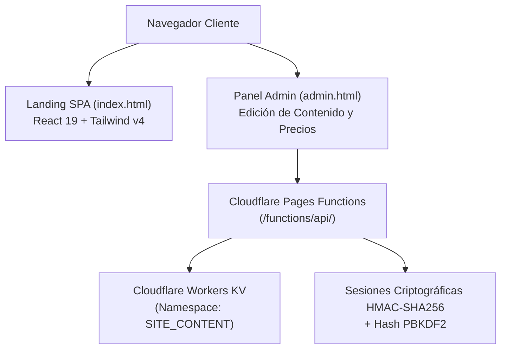

# Arquitectura del Sistema — TOTALHIIT (Sitio Web & Admin)

## Visión General
El proyecto es una **SPA (Single Page Application)** con backend serverless en el Edge de Cloudflare:

## Estructura de Directorios
- `functions/api/`: Endpoints serverless Edge para autenticación (`/auth.ts`) y contenido (`/content.ts`).
- `src/`:
  - `components/`: Hero con collage dinámico, BootcampModules (4 semanas), Pricing, PaymentModal, VideoModal.
  - `admin/`: Componentes del panel administrativo, autenticación y gestión de estado KV.
  - `data/`: Datos estáticos de fallback (`bootcampData.ts`, `heroCollage.ts`).
- `public/`: Miniaturas optimizadas, videos y tipografías comerciales libres (fuente Edo).
